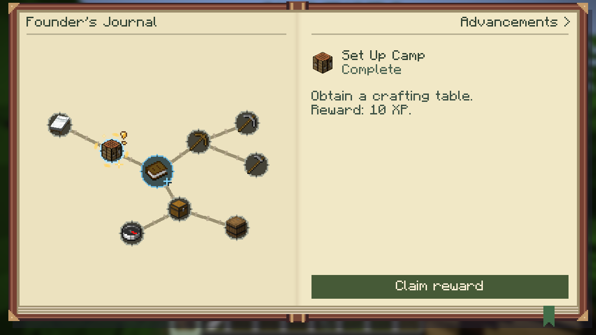
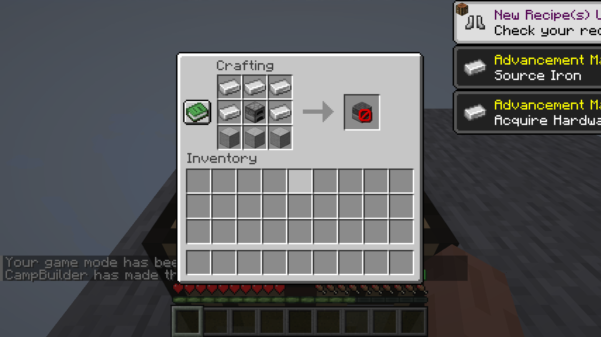

# Horizon Quest Journal

**Public beta 1.1.2-beta.1 · Horizon 26.3.** Press **L** to open a hardcover journal, follow the branches of a chapter and select a quest to read its objective and rewards. Obtain a crafting table in the Founders chapter to complete **Set Up Camp**, select its gold exclamation mark and choose **Claim reward** for 10 XP.



[Download the Founders pack and example profiles](https://github.com/Fnux8890/horizon-quest-journal/releases/tag/v1.1.2-beta.1)

## Build the beta runtime

The book, claim button and player crafting rules require a patched Horizon executable. The downloadable Founders ZIP supplies world data. For solo play, build the client and open a local world. For multiplayer, use matching patched builds on the clients and the host. This beta distributes source and world data. Bring your own Horizon-compatible Minecraft 26.3 resources.

From a checkout of this beta, with Git, the Horizon build prerequisites and Rust installed, run:

```sh
git clone https://github.com/horizon-rust/horizon.git engine
git -C engine checkout --detach 7bf49fa2810efa4e293e8867cabe831fea59378d
git -C engine apply --check ../patches/quest-map.patch
git -C engine apply ../patches/quest-map.patch
cargo build --manifest-path engine/Cargo.toml --locked --profile fast -p horizon-client --bin horizon-client
```

Start the built executable under `engine/target/fast/` with your normal Horizon game directory and extracted resources. Use a fresh beta world. Place the Founders ZIP in that world's `datapacks/` directory and reopen the world. An operator can run `/reload`, inspect `/datapack list`, and use `/datapack enable "file/<filename>.zip"` if the pack is available but disabled. In single-player you can also select the pack at world creation. The registry entry installs this chapter. On the ordinary engine, the advancement data can load, but the book and its claim interface require the patched runtime.

## Add quests to a mod

Use Python 3.10+ from the repository root:

```sh
python tools/quest-journal/journal.py init workshop --namespace workshop --title "Workshop Journal"
python tools/quest-journal/journal.py check workshop
python tools/quest-journal/journal.py build workshop workshop.zip
```

Install the ZIP in a test world. Obtain iron for the first quest. For the custom job, have your mod invoke `function #workshop:api/v1/job_completed` as the credited player after its action succeeds. The generated companion grants progress. Give each mod its own namespace and keep released advancement IDs stable across upgrades. The [SDK guide](tools/quest-journal/README.md) covers native callbacks, optional listeners, adding children to another mod's chapter, block-item loot and manual claims.

## Shape a modpack

Load dependencies first and your pack's overrides last. To change an existing quest, chapter or rule, put its same namespace and path in your override pack. To add an independent prerequisite, give the crafting rule a new ID. Quest completion unlocks crafting even if the player waits to collect the reward.

```sh
python examples/press-profiles/export.py beginner beginner-world.zip
python examples/press-profiles/export.py expert expert-world.zip
```

Extract one profile into a fresh world directory. In Expert, assemble a blast furnace before obtaining a crafting table. The result shows a red barrier. Complete **Set Up Camp** and the result becomes craftable. Beginner permits ordinary blast-furnace crafting. The [profile walkthrough](examples/press-profiles/README.md) describes the rail press, colony connector and override order. The [crafting guide](docs/quest-gated-crafting.md) gives the rule JSON and validation command.



## Contribute

Run `python tools/quest-journal/test_journal.py` before opening a PR. For a gameplay change, include the engine revision, profile, solo or multiplayer steps and expected result. For UI changes, include an in-game screenshot. The original source and pack definitions use the [MIT license](LICENSE). The engine patch includes Horizon code under its [original MIT notice](tools/quest-journal/HORIZON-LICENSE.txt). See [provenance](tools/quest-journal/PROVENANCE.md).
