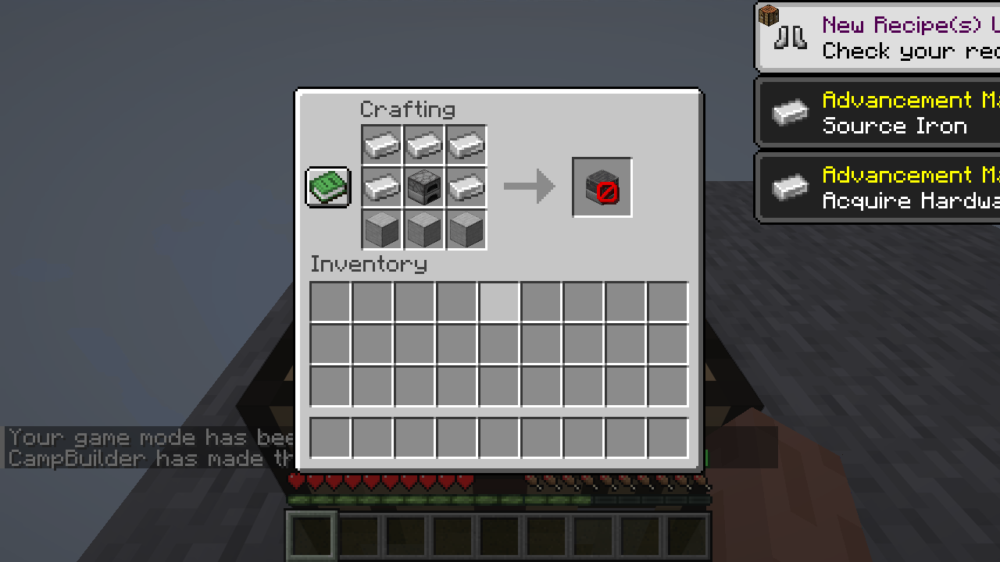

# Quest-gated crafting for modpack authors

Author guide for the journal-aware Horizon 26.3 build. The first pilot is a pack rule that gates crafting a blast furnace on completing Set Up Camp. The beginner profile omits it. The expert profile opts in. Both profiles use the same machine and journal code.

When a recipe is locked, the output slot shows the item with a small red circle and slash. Completing its required quest clears the mark while the crafting screen is open. The badge uses the active resource pack's `assets/minecraft/textures/item/barrier.png` texture.

## Add a rule

A file at data/railworks/progression_rule/blast_furnace.json defines the rule railworks:blast_furnace.

~~~json
{
  "version": 1,
  "action": "craft",
  "output": "minecraft:blast_furnace",
  "requires": {"quest_completed": "horizon:workbench"},
  "scope": "player"
}
~~~

The runtime matches the final primary output item. Alternate player crafting recipes that produce the same block follow the same rule. A future recipe-ID selector would allow selective alternate recipes. Resolve the acting player's completed objective independently of its reward receipt. Keep the block usable when found in loot, traded, or placed unless the author separately opts into those action types. Higher-priority packs replace a rule under the same resource ID. If distinct rules target the same action, every applicable prerequisite must pass.

## Select, override and remove

Load the quest dependency before the modpack rule pack. Supply the same namespace and path in a higher-priority pack to replace all fields. Removing an override reveals a lower-priority definition of the same ID. To restore ordinary crafting, remove the rule and reload or disable its pack.

For a complete folder layout, pack metadata and an in-game check, follow the [two-file example](../README.md#gate-a-recipe-with-a-data-pack).

## Optional authoring tools

The [Rust CLI](../tools/quest-journal-rs/README.md) also accepts the check command below. Replace `python tools/quest-journal/journal.py` with `quest-journal` to use it.

In a development checkout, the SDK checks rule structure and cross-pack quest references. Supply the target game's resource folder to check registered item IDs and built-in quests. From the workspace root:

~~~powershell
python examples/press-profiles/export.py expert expert-world.zip
python tools/quest-journal/journal.py check examples/press-profiles/expert_rules --resources "<extracted-game-resources>" --dependency datapacks/horizon_quests --dependency datapacks/engineering_press --dependency datapacks/colony_workshop --dependency datapacks/frontier_connector
~~~

The exported ZIP contains a fresh world's packs and their selection order. Extract it into a separate world before opening it with the patched engine. The expert blast furnace unlocks when the player obtains a crafting table. Claiming the XP can wait. The beginner profile keeps ordinary crafting.

Loot, trades, placed blocks, furnace processing, unattended Crafters and independent mod machines retain their respective production rules. A custom machine needs its own check before spending inputs.

[Editor schema](../tools/quest-journal/progression-rule-v1.schema.json) · [Expert rule](../examples/press-profiles/expert_rules/data/railworks/progression_rule/blast_furnace.json)
